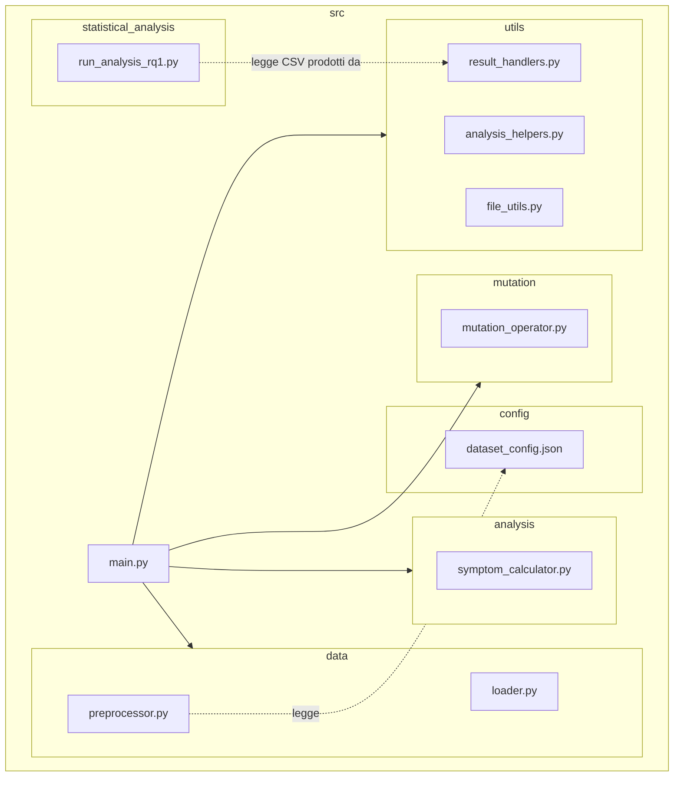
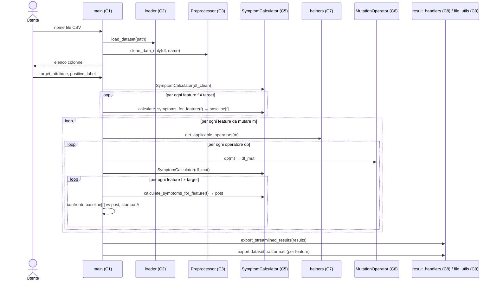

# FADE – Ricostruzione di architettura e comportamento (baseline per l'Impact Analysis)

> Documento di *reverse engineering* prodotto sul commit `33a9dd3` (branch `Managment`).
> Scopo: fornire la baseline (componenti, dipendenze, flussi, punti critici) su cui condurre
> l'impact analysis a grana grossa delle tre Change Request (CR) del gruppo.

---

## 1. Il sistema in breve

**FADE (Fairness Assessment under Dataset Evolution)** è un tool Python a riga di comando che:

1. carica un dataset tabellare CSV (benchmark: `adult`, `bank`, `compas`, `diabetic`);
2. calcola, per ogni feature (escluso il target), **13 "sintomi"** di bias a livello di dataset (baseline);
3. applica a ogni feature degli **operatori di mutazione** (rumore controllato sui dati);
4. ricalcola i sintomi su tutte le feature del dataset mutato e registra le differenze pre/post;
5. esporta i risultati in CSV e i dataset mutati;
6. uno **script separato di analisi statistica** (RQ1) aggrega i CSV, esegue Wilcoxon + FDR e calcola un *Composite Fragility Score* (CFS) per individuare le feature "fairness-fragile".

Nessun modello di ML viene addestrato: tutte le metriche sono *data-level*.

| Dato | Valore |
|---|---|
| Linguaggio | Python ≥ 3.9 (usa `tuple[str, str]`), testato localmente con 3.12 |
| LOC sorgente | ~1.700 in 9 moduli |
| Test automatici | **nessuno** |
| Entry point | `src/main.py` (interattivo), `src/statistical_analysis/run_analysis_rq1.py` (batch) |
| Librerie effettivamente usate | pandas, numpy, scipy, scikit-learn, nltk (WordNet), statsmodels |
| Librerie dichiarate ma non usate | torch (importato ma mai usato), transformers, tensorflow, flax, tf-keras, sentencepiece, matplotlib |

---

## 2. Architettura

### 2.1 Vista a componenti

Lo stile è una **pipeline batch** (pipe & filter) orchestrata da uno script monolitico, più un secondo programma indipendente accoppiato **solo tramite file CSV** (data coupling).

```mermaid
flowchart LR
    subgraph IN[Input]
        CSV[(data/*.csv)]
        CFG[(config/dataset_config.json)]
        USR([Utente - stdin])
    end

    subgraph P1[Programma 1 - src/main.py]
        MAIN[C1 main.py<br/>orchestratore]
        LOAD[C2 loader]
        PRE[C3 DataPreprocessor]
        HELP[C7 analysis_helpers]
        MUT[C6 MutationOperator]
        SYM[C5 SymptomCalculator]
        RES[C8 result_handlers]
        FU[C9 file_utils]
    end

    subgraph OUT[Artefatti su disco]
        RCSV[(results/results_ds_ts.csv)]
        TDS[(results/feature_f_ts/transformed_*.csv)]
    end

    subgraph P2[Programma 2 - run_analysis_rq1.py]
        RQ1[C10 run_analysis_rq1]
    end

    AGG[(results/results.csv)]
    FA[(results/fade_analysis.csv)]
    SS[(results/symptom_sensitivity_results.csv)]

    USR --> MAIN
    CSV --> LOAD --> MAIN
    CFG --> PRE
    MAIN --> PRE
    MAIN --> HELP
    MAIN --> MUT
    MAIN --> SYM
    MAIN --> RES --> RCSV
    MAIN --> FU --> TDS
    RCSV -. glob results_*.csv .-> RQ1
    RQ1 --> AGG & FA & SS
```

### 2.2 Catalogo dei componenti

| ID | Modulo | Responsabilità | LOC | Usato da |
|---|---|---|---|---|
| C1 | `src/main.py` | Orchestrazione: I/O utente, baseline, ciclo feature×operatore×feature-sensibile, report console, export | 236 | – (entry point) |
| C2 | `src/data/loader.py` | `load_dataset()`: lettura CSV con gestione errori | 21 | C1 |
| C3 | `src/data/preprocessor.py` | `DataPreprocessor.clean_data_only()`: drop feature da config, `?`→NA, rimozione righe con NA. Contiene anche one-hot encoding **non usato** | 332 | C1 |
| C4 | `src/config/dataset_config.json` | Feature da ignorare per dataset (es. `fnlwgt`, `education.num` per adult) | 19 | C3 |
| C5 | `src/analysis/symptom_calculator.py` | `SymptomCalculator`: 13 sintomi + inferenza automatica gruppi privilegiato/non privilegiato | 276 | C1 |
| C6 | `src/mutation/mutation_operator.py` | `MutationOperator`: 5 operatori di mutazione + stampa confronto pre/post | 422 | C1 |
| C7 | `src/utils/analysis_helpers.py` | `get_applicable_operators()` (dtype → operatori). `get_user_defined_conditions()` **non usata** | 63 | C1 |
| C8 | `src/utils/result_handlers.py` | `export_streamlined_results()`: risultati in formato "una riga per sintomo". `generate_comprehensive_final_dataset()` **non usata** | 105 | C1 |
| C9 | `src/utils/file_utils.py` | `create_feature_directory_structure()`. `export_transformed_datasets_hierarchical()` **non usata** | 56 | C1 |
| C10 | `src/statistical_analysis/run_analysis_rq1.py` | Aggregazione CSV, CFS (RQ1-B), Wilcoxon + rank-biserial + Benjamini-Hochberg (RQ1-A) | 173 | – (entry point) |
| D1 | `data/*.csv` | 4 dataset benchmark | – | C2 |
| D2 | `results/**` | Output e risultati sperimentali già committati (incl. `dataset-RQ2/`, **senza codice che lo generi**) | ~47k righe CSV | C10 |

### 2.3 Matrice delle dipendenze (chi dipende da chi)

Legenda: **I** = import/chiamata diretta, **S** = accoppiamento tramite stringhe/chiavi condivise, **F** = accoppiamento tramite file/schema CSV.

| ↓ dipende da → | C2 | C3 | C4 | C5 | C6 | C7 | C8 | C9 | C10 |
|---|---|---|---|---|---|---|---|---|---|
| **C1 main** | I | I | | I, S | I, S | I, S | I, S | I | |
| **C3 preprocessor** | | | F | | | | | | |
| **C8 result_handlers** | | | | S | | | | | |
| **C10 rq1** | | | | S | | S | F | | |

Gli accoppiamenti **impliciti (S/F)** sono quelli più insidiosi per l'impact analysis, perché non emergono da un'analisi degli import:

| Contratto implicito | Definito in | Consumato in |
|---|---|---|
| Nomi operatori (`'increment_decrement_feature'`, `'scale_values'`, `'category_flip'`, `'replace_synonyms'`, `'add_noise'`) | C7 `get_applicable_operators` | C1 (dispatch `if/elif`), nomi file transformed, colonna CSV `mutation_type`, C10 (`groupby`) |
| Nomi sintomi (chiavi del dict: `'Gini Index'`, …) | C5 `calculate_symptoms_for_feature` | C1 (prefissi `pre_`/`post_`), C8 (strip dei prefissi), colonna `symptom_name`, C10 |
| Chiavi del dict risultato (`mutation_source_feature`, `sensitive_attr_analyzed`, …) | C1 | C8 |
| Schema CSV streamlined (`dataset`, `column`, `column_type`, `mutation_type`, `symptom_name`, `pre_symptom_value`, `post_symptom_value`, `symptom_percent_change`) | C8 | C10 |
| Convenzione nomi file `results_*.csv` nella cartella `results/` | C8 | C10 (`glob`) |
| Path relativi (`../data`, `../../results`) calcolati da `__file__` | C1, C3, C8, C9, C10 | file system |

### 2.4 Package diagram



**Commento.**
- I package (`data`, `analysis`, `mutation`, `utils`) sono semplici cartelle, senza `__init__.py`. Gli import funzionano solo eseguendo il codice da `src/` (`cd src && python main.py`): il codice non è installabile come pacchetto e non è importabile dai test senza manipolare `sys.path`.
- Tutte le dipendenze sono **entranti in `main.py`**: i package non si conoscono tra loro. L'architettura è quindi "a stella": un hub con la logica di controllo e foglie con la logica di dominio. È un buon punto di partenza per il refactoring (le foglie sono già disaccoppiate), ma l'hub concentra tutto il controllo e non è testabile.
- `utils` è un package "contenitore" con responsabilità eterogenee: selezione degli operatori (logica di dominio), export dei risultati (I/O), gestione delle cartelle (I/O). È un indizio di *low cohesion*.
- `statistical_analysis` non ha dipendenze di codice verso il resto del sistema: dipende solo dal **formato** dei CSV. Il disaccoppiamento è forte, ma il contratto è implicito e non verificato.

### 2.5 Class diagram

```mermaid
classDiagram
    class DataPreprocessor {
        +dict feature_types
        +dict preprocessing_info
        +dict config
        -_load_config() dict
        +identify_feature_types(df) dict
        +drop_ignored_features(df, dataset_name) DataFrame
        +handle_missing_values(df) DataFrame
        +clean_data_only(df, dataset_name) tuple
        +encode_categorical_features(df) DataFrame «non usato»
        +fit(df) «non usato»
        +transform(df, dataset_name) «non usato»
        +fit_transform(df, dataset_name) «non usato»
        +apply_temporary_encoding(df) «non usato»
        +get_preprocessing_summary() «non usato»
    }

    class SymptomCalculator {
        +DataFrame df
        +str target_attribute
        +int positive_label «mai letto»
        +infer_group_conditions(feature) tuple
        -_get_groups(unpriv_q, priv_q) tuple
        +calculate_symptoms_for_feature(feature) dict
    }

    class symptom_functions {
        <<module functions>>
        +calculate_gini_inequality(x) float
        +calculate_shannon_entropy(x) float
        +calculate_simpson_index(x) float
        +calculate_imbalance_ratio(x) float
    }

    class MutationOperator {
        +DataFrame dataframe
        +increment_decrement_feature(feature, percentage) DataFrame
        +scale_values(feature, percentage) DataFrame
        +category_flip(feature, percentage) DataFrame
        +replace_synonyms(col, row_pct, word_pct) DataFrame
        +add_noise(col, percentage) DataFrame
        -_synonym_replacement(text, word_pct) str
        -_introduce_noise(text) str
        -_show_comparison(orig, mod, idx, feature, op)
    }

    class main {
        <<script>>
    }
    class analysis_helpers {
        <<module>>
        +get_applicable_operators(column, df) list
        +get_user_defined_conditions(attr, df) «non usato»
    }
    class result_handlers {
        <<module>>
        +export_streamlined_results(results, file_path) str
        +generate_comprehensive_final_dataset(...) «non usato»
    }
    class file_utils {
        <<module>>
        +create_feature_directory_structure(base, feature, ts) str
        +export_transformed_datasets_hierarchical(...) «non usato»
    }
    class loader {
        <<module>>
        +load_dataset(file_path) DataFrame
    }

    main ..> loader
    main ..> DataPreprocessor : 1 istanza
    main ..> SymptomCalculator : 1 + n. mutazioni istanze
    main ..> MutationOperator : 1 istanza
    main ..> analysis_helpers
    main ..> result_handlers
    main ..> file_utils
    SymptomCalculator ..> symptom_functions
```



**Commento.**
- Nel sistema ci sono **solo 3 classi**, e nessuna gerarchia, interfaccia o polimorfismo. Il resto è procedurale (funzioni di modulo e script).
- `MutationOperator` non rappresenta *un* operatore ma *il catalogo* degli operatori: ogni operatore è un metodo. Il chiamante sceglie quale invocare con una catena `if/elif` su stringhe, e aggiungere un operatore significa modificare la classe, il dispatch in `main` e `analysis_helpers` (violazione dell'Open/Closed Principle). Il metodo `_show_comparison` mescola calcolo e presentazione.
- `SymptomCalculator.calculate_symptoms_for_feature` è un metodo lungo (~120 LOC) che calcola tutti i 13 sintomi in sequenza, restituendoli come `dict` con chiavi stringa. Non si può selezionare, disattivare o aggiungere un sintomo senza modificare il metodo. Anche l'inferenza dei gruppi (una strategia di per sé) è cablata nella classe.
- `DataPreprocessor` contiene più codice morto (~120 LOC) che codice usato: è il residuo di una versione precedente della pipeline basata sul one-hot encoding.
- Lo stato condiviso fra i componenti è un `pandas.DataFrame` copiato a ogni passo (`df.copy()` in tutti gli operatori e nel costruttore di `SymptomCalculator`). L'approccio è sicuro, ma costa memoria su dataset grandi: con *k* mutazioni restano in memoria *k* copie del dataset fino all'export finale (`transformed_datasets` in `main`).

---

## 3. Comportamento

### 3.1 Flusso principale (`src/main.py`)



**Complessità:** per un dataset con *F* feature si eseguono ≈ *F × k × F* calcoli di sintomi (*k* = 2 operatori per feature numeriche, 3 per categoriche). È la parte dominante del tempo di esecuzione; il calcolo della Mutual Information è il più oneroso.

### 3.2 Pre-processing (C3)

`clean_data_only` (unico metodo usato):
1. elimina le feature indicate in `dataset_config.json` (chiave = nome file; altrimenti `default`);
2. identifica i tipi delle feature (risultato non usato a valle);
3. sostituisce `'?'` con NA e **elimina tutte le righe** con almeno un NA.

Il one-hot encoding (`transform`, `fit_transform`, `apply_temporary_encoding`) è codice morto: mutazioni e sintomi lavorano sui valori grezzi.

### 3.3 Operatori di mutazione (C6)

La scelta dipende solo dal dtype pandas (C7): numerico → 2 operatori; altrimenti → 3 operatori.

| Operatore | Tipo | Comportamento | Parametri (hard-coded in C1) |
|---|---|---|---|
| `increment_decrement_feature` | numerico | ± U(−5%, +5%) del range, poi cast al dtype originale (troncamento per interi) | 20% righe |
| `scale_values` | numerico | × U(0.8, 1.2); arrotondamento se intero | 20% righe |
| `category_flip` | categorico | per ogni categoria, il 15% delle istanze (min 1) passa a un'altra categoria casuale | 15% (default) |
| `replace_synonyms` | testuale | nel 10% delle righe sostituisce il 15% delle parole con sinonimi WordNet | 10% righe, 15% parole |
| `add_noise` | testuale | swap/insert/delete/substitute di caratteri; se ≤ 45 valori distinti applica **la stessa** mutazione a tutte le occorrenze di una categoria (crea una nuova categoria "sporca") | 10% righe |

Ogni operatore lavora su una copia di `self.dataframe` e stampa a console il confronto riga per riga.
La casualità usa sia `random` sia `np.random` **senza seed** → esecuzioni non riproducibili.

### 3.4 Sintomi (C5)

Per ogni feature *f* (trattata di volta in volta come potenziale attributo sensibile):

| Categoria | Sintomi | Note |
|---|---|---|
| A – Distribuzione | Gini Index, Shannon Entropy, Simpson Diversity, Imbalance Ratio | sulle frequenze dei valori |
| A – Forma (solo numerici) | Kurtosis, Skewness | `None` per categoriche |
| B – Relazione col target | Mutual Information, Kendall Tau (solo numerici) | MI: `mutual_info_classif` (o `_regression` se target con > 20 valori); errori → 0.0 |
| C – Fairness di gruppo | Data Statistical Parity, Unprivileged/Privileged Positive Probability, Unprivileged/Privileged Group Unbalance | richiedono l'inferenza dei gruppi |

**Inferenza dei gruppi** (`infer_group_conditions`):
- numerica con > 20 valori distinti → split alla mediana; il gruppo con tasso positivo più basso è "non privilegiato";
- altrimenti → categoria con tasso positivo minimo = non privilegiata, massimo = privilegiata;
- i gruppi vengono poi estratti con `DataFrame.query()` su stringhe costruite dinamicamente.

> ⚠️ Il "tasso positivo" è calcolato come `mean()` della colonna target: **`positive_label` richiesto all'utente non viene mai usato**. Il sistema assume implicitamente un target codificato 0/1.

### 3.5 Output

| Artefatto | Prodotto da | Path effettivo nel codice |
|---|---|---|
| Risultati streamlined (1 riga per mutazione × feature analizzata × sintomo; scartate le righe con `None`) | C8 | `results/results_<dataset>_<timestamp>.csv` |
| Dataset trasformati | C1 + C9 | `results/feature_<feature>_<timestamp>/transformed_<dataset>_<feature>_<op>.csv` |

`symptom_percent_change` vale **0** quando il valore baseline è 0 (anziché indefinito); `is_sensitive` è sempre `False`.

### 3.6 Analisi statistica (C10)

1. **Aggregazione:** concatena tutti i `results/results_*.csv` → `results/results.csv`.
2. **RQ1-B – CFS:** per (dataset, feature, operatore) calcola media/mediana/max di `|symptom_percent_change|`; "High Risk" = sopra l'80° percentile del dataset → `fade_analysis.csv`.
3. **RQ1-A – Sensibilità dei sintomi:** per ciascun sintomo, Wilcoxon signed-rank pre vs post su tutti gli eventi, effect size rank-biserial, trend (Increase/Decrease/Mixed/Stable), correzione BH-FDR (α = 0.05) → `symptom_sensitivity_results.csv`.

---

## 4. Discrepanze, debito tecnico e rischi rilevanti per l'impact analysis

| # | Osservazione | Dove | Perché conta per le CR |
|---|---|---|---|
| R1 | **Nessun test automatico**; `main.py` è tutto dentro `if __name__ == '__main__'` (nessuna funzione testabile) | C1 | Ogni CR richiede di costruire prima una rete di sicurezza (test di regressione) o accettare verifica manuale |
| R2 | **Esecuzione non deterministica** (nessun seed) | C6 | Impossibile confrontare output prima/dopo una modifica in modo esatto |
| R3 | `positive_label` ignorato; target assunto 0/1 | C5 | Qualsiasi CR su target/etichette tocca C5 in più punti |
| R4 | Struttura `results/` nel repo (`results/<ds>/feature_<f>/`, `results_<ds>.csv`) **diversa** da quella prodotta dal codice (`results/feature_<f>_<ts>/`, `results_<ds>_<ts>.csv`); il README descrive un misto | C1, C8, C9, README, D2 | Gli output committati sono stati riorganizzati a mano: non sono rigenerabili "as is" |
| R5 | Aggregazione con `glob("results_*.csv")`: dopo una nuova esecuzione vengono sommati **sia** i file baseline **sia** quelli con timestamp → righe duplicate | C10 | Falsa i risultati statistici dopo qualsiasi rerun |
| R6 | Dispatch operatori con `if/elif` in C1 + lista in C7 + nomi stringa (violazione OCP) | C1, C7 | Aggiungere/modificare un operatore impatta almeno 3 punti |
| R7 | Parametri di mutazione e soglie (20/15/10%, 0.01, 0.1, 20 valori, 45 valori, 80° percentile) **hard-coded** | C1, C5, C6, C10 | Una CR di "configurabilità" ha impatto trasversale |
| R8 | Codice morto: one-hot encoding (C3), `get_user_defined_conditions` (C7), `generate_comprehensive_final_dataset` (C8), `export_transformed_datasets_hierarchical` (C9) | C3, C7, C8, C9 | Gonfia l'impact set apparente; `get_user_defined_conditions` è un possibile punto di riuso (gruppi definiti dall'utente) |
| R9 | Dipendenze pesanti inutili (torch importato in C6; tensorflow, transformers, flax, …) | `requirements.txt`, C6 | Installazione lenta/fragile, specie su Windows |
| R10 | Eccezioni per operatore catturate e solo stampate | C1 | Errori introdotti da una modifica possono passare inosservati |
| R11 | `results/dataset-RQ2/` (RQ2, valutazione su modelli) **non ha codice** che lo produca | D2 | Se una CR riguarda RQ2, è sviluppo nuovo, non manutenzione |
| R12 | `sort_values('p_adj')` fallisce se non ci sono sintomi; `is_categorical_dtype` deprecato in pandas recenti | C10, C3 | Rischi di rottura con aggiornamenti di librerie |

---

## 5. Mappa preliminare "tipo di modifica → componenti impattati"

Utile come primo filtro per individuare lo **Starting Impact Set (SIS)** di ciascuna CR; il **Candidate Impact Set (CIS)** si ottiene poi propagando lungo la matrice del §2.3 (inclusi gli accoppiamenti S/F).

| Tipo di modifica | SIS (impatto diretto) | Propagazione (CIS) | Stima |
|---|---|---|---|
| Nuovo operatore di mutazione | C6 | C7, C1 (dispatch); automaticamente CSV e C10 | Bassa–media |
| Modifica parametri/configurabilità degli operatori | C1, C6 | C4 (se in config), README | Media |
| Nuovo sintomo / modifica di un sintomo | C5 | Automatico in C1, C8, C10 (tutto generico sulle chiavi); risultati in D2 non più confrontabili | Bassa (codice) / Alta (dati) |
| Gruppi privilegiati definiti dall'utente / uso di `positive_label` | C5 | C1 (input), C7 (riuso `get_user_defined_conditions`), C4 | Media |
| Nuovo formato di input (non CSV, CLI non interattiva, batch su più dataset) | C1, C2 | C3, C4 | Media |
| Modifica schema/struttura dei risultati | C8, C9, C1 | C10, D2, README | Media–alta |
| Nuove analisi statistiche / RQ | C10 | dipende dallo schema CSV (C8) | Bassa–media |
| Valutazione con modelli ML (RQ2) | nuovo componente | C1 o C10, `requirements.txt`, D2 | Alta |
| Refactoring per testabilità / riproducibilità | C1, C6 | tutti (introduzione test, seed) | Media |

---

## 6. Prossimo passo

Per ciascuna delle tre CR compilare:

| Campo | Contenuto |
|---|---|
| CR-ID e descrizione | |
| SIS | componenti modificati direttamente (da §2.2 / §5) |
| CIS | SIS + propagazione lungo dipendenze I/S/F (§2.3) |
| Rischi coinvolti | riferimenti R1…R12 (§4) |
| Stima (bassa/media/alta) e motivazione | |
| Interazioni con le altre CR | componenti condivisi → ordine di implementazione consigliato |
