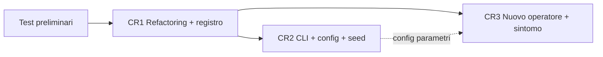

# FADE – Analisi d'impatto preliminare (grana grossa) delle Change Request

> Baseline: commit `33a9dd3`. Componenti e rischi sono quelli definiti in
> [01_architettura_e_comportamento.md](01_architettura_e_comportamento.md) (C1–C10, D1–D2, R1–R12).
>
> **Nota:** le slide del corso ("Regole di Ingaggio") avvertono che non esistono documenti standard,
> e in particolare che *il documento di "Impact Analysis" non esiste*. Questo file è quindi un **materiale
> di lavoro**: i contenuti di ciascuna sezione vanno riportati **dentro la relativa CR**, nella struttura
> richiesta dal corso. Le CR devono essere reperibili nel repository, perché i commit vi fanno riferimento.
>
> In fase di *Progettazione modifica* l'architettura target della CR1 (§2.2) va espressa come evoluzione
> dei modelli estratti (package e class diagram, §2.4–2.5 del doc. 01). Gli insiemi d'impatto (CIS) di
> ogni CR sono la base per **selezionare i test di regressione** da rieseguire.

---

## 0. Convenzioni

**Profondità dell'impatto** (richiesta esplicitamente dal tutor per la CR1):

| Livello | Significato |
|---|---|
| — | Non toccato |
| **B** – Bassa | Modifiche locali e superficiali: import, path, rinomina, spostamento senza cambiare la logica |
| **M** – Media | Alcune funzioni/firme cambiano, la struttura del modulo resta riconoscibile |
| **A** – Alta | Il modulo viene ristrutturato o riscritto; la sua interfaccia cambia |
| **N** – Nuovo | File/modulo nuovo |
| **X** – Eliminato | Il file o il codice viene rimosso |

**Insiemi d'impatto:**
- **SIS** (*Starting Impact Set*): componenti modificati direttamente per realizzare la CR;
- **CIS** (*Candidate Impact Set*): SIS più i componenti raggiunti seguendo le dipendenze (import **I**, stringhe/chiavi condivise **S**, file/schema CSV **F**, cfr. §2.3 del doc. 01).

**Vincolo trasversale proposto (contenimento dell'impatto).** Durante le tre CR restano **invariati**:
1. lo schema del CSV dei risultati (colonne prodotte da C8);
2. i nomi degli operatori e dei sintomi già esistenti (che compaiono nei CSV e nei nomi dei file).

Rispettando questi due vincoli, l'analisi statistica (C10) e i risultati già committati (D2) restano compatibili, e l'impatto si ferma ai confini del Programma 1.

---

## 1. Attività preliminare – Test di caratterizzazione e regressione

Non è una CR, ma è un prerequisito di tutte e tre (rischio R1) e incide sul piano.

| Aspetto | Contenuto |
|---|---|
| Obiettivo | Fissare il comportamento attuale prima di modificarlo |
| Nuovi artefatti | `tests/` (pytest), dataset ridotti per i test (`tests/fixtures/`), `pytest` nei requisiti di sviluppo |
| Codice di produzione toccato | Nessuno (solo `—`), salvo l'aggiunta di un `conftest.py` |
| Cosa testare | **Unit:** le 4 funzioni di distribuzione e i sintomi di C5 su input fissati (sono deterministici); l'inferenza dei gruppi; `clean_data_only`; `get_applicable_operators`; l'export di C8 (schema delle colonne). **Proprietà degli operatori:** % di righe modificate, dtype preservato, valori entro i limiti (±5% del range, fattore 0.8–1.2), categorie di destinazione esistenti. **Golden master end-to-end:** esecuzione completa su un dataset piccolo, con `random.seed` e `np.random.seed` fissati nel test |
| Limite | Il golden master dipende dall'ordine con cui viene consumato il generatore casuale. La CR1 e la CR2 cambieranno quell'ordine (RNG iniettato): il golden master andrà **rigenerato una volta, in modo controllato**, mentre i test unitari e di proprietà devono restare verdi senza modifiche |

---

## 2. CR1 – Ristrutturazione: componenti registrabili e configurabili + refactoring generale

### 2.1 Descrizione
- Operatori di mutazione e sintomi diventano **componenti con un'interfaccia comune**, scoperti tramite un **registro**. Il nucleo non contiene più nomi cablati né catene `if/elif`.
- Ogni componente dichiara i propri parametri e i default (oggi hard-coded in C1, C5, C6), che diventano configurabili. L'esposizione tramite CLI/file è compito della CR2.
- **Refactoring generale** (indicazione del tutor): scomposizione di `main.py`, separazione delle responsabilità (calcolo, I/O, reporting a console), eliminazione di codice morto e dipendenze inutili, centralizzazione di path e soglie, iniezione del generatore casuale.

### 2.2 Architettura target (indicativa)

```
src/
  fade/
    core/
      runner.py          # ciclo baseline → mutazione → ricalcolo (ex corpo di main.py)
      registry.py        # registro generico (decoratore @register)
      context.py         # dataset, target, positive_label, rng, parametri
    mutation/
      base.py            # MutationOperator (ABC): name, is_applicable(series), apply(df, col, rng, **params)
      numeric.py         # increment_decrement_feature, scale_values
      categorical.py     # category_flip, replace_synonyms, add_noise
    symptoms/
      base.py            # Symptom (ABC): name, category, is_applicable(series), compute(ctx, feature)
      distribution.py    # Gini, Shannon, Simpson, Imbalance Ratio, Kurtosis, Skewness
      relationship.py    # Mutual Information, Kendall Tau
      group_fairness.py  # DSP, UPP, PPP, Unpriv/Priv Group Unbalance
      groups.py          # inferenza gruppi (ex infer_group_conditions)
    data/
      loader.py, preprocessor.py
    io/
      results_writer.py  # ex result_handlers + export dataset trasformati (ex file_utils + coda di main)
      paths.py
    reporting/
      console.py         # stampe Δ, "SIGNIFICANT CHANGE", confronti pre/post (ex _show_comparison)
  main.py                # entry point sottile (resta interattivo fino alla CR2)
  statistical_analysis/run_analysis_rq1.py
```

### 2.3 SIS e CIS con profondità

| Comp. | File | Prof. | Cosa cambia |
|---|---|---|---|
| C1 | `main.py` | **A** | Il corpo (≈200 LOC) passa a `core/runner.py` e `reporting/console.py`; il dispatch `if/elif` viene sostituito dal registro; l'export dei dataset trasformati passa a `io/`. Resta un entry point di poche righe |
| C5 | `analysis/symptom_calculator.py` | **A** | Il metodo unico `calculate_symptoms_for_feature` viene scomposto in 13 componenti registrati; l'inferenza dei gruppi va in un modulo a sé; le soglie (20 valori distinti) diventano parametri. Il calcolo delle formule resta identico |
| C6 | `mutation/mutation_operator.py` | **A** | La classe unica con 5 metodi diventa 5 classi con base astratta; RNG iniettato (oggi `random` + `np.random` globali); `_show_comparison` passa al reporting; rimozione di `import torch`; percentuali e soglia dei 45 valori come parametri |
| C7 | `utils/analysis_helpers.py` | **X / A** | `get_applicable_operators` è sostituita da `is_applicable` + registro. `get_user_defined_conditions` (non usata): da rimuovere oppure da spostare in `groups.py` come strategia alternativa di inferenza (decisione del gruppo) |
| C3 | `data/preprocessor.py` | **M** | Rimozione del codice morto (one-hot encoding, `fit`/`transform`/`fit_transform`/`apply_temporary_encoding`, `get_preprocessing_summary`: ≈120 LOC); sostituzione di `is_categorical_dtype`, deprecato; path del config centralizzato |
| C8 | `utils/result_handlers.py` | **M** | Rimozione di `generate_comprehensive_final_dataset` (non usata); il risultato passa da dict con prefissi `pre_`/`post_` a oggetto strutturato; **schema CSV invariato** |
| C9 | `utils/file_utils.py` | **M / X** | Rimozione di `export_transformed_datasets_hierarchical` (non usata); il resto confluisce in `io/` |
| C2 | `data/loader.py` | **B** | Spostamento/import |
| C4 | `config/dataset_config.json` | **B** | Invariato nel contenuto; letto tramite il modulo dei path |
| C10 | `run_analysis_rq1.py` | **B** | Scomposizione in funzioni per renderlo testabile. **Correzione di R5** (doppio conteggio nel `glob`), se il gruppo la include. Logica statistica invariata |
| — | `requirements.txt` | **M** | Rimozione di torch, tensorflow, transformers, flax, tf-keras, sentencepiece, matplotlib (R9); separazione dei requisiti di sviluppo |
| — | `README.md` | **M** | Sezioni Architecture, Project Structure, Workflow |
| D2 | `results/` | — | Nessun impatto, grazie al vincolo sullo schema |
| — | `tests/` | **M** | Aggiornamento degli import e rigenerazione controllata del golden master |

**Dimensione:** circa il **75–80% del codice sorgente** (≈1.300 delle ≈1.700 LOC) viene toccato, di cui ≈900 LOC in profondità alta (C1, C5, C6, C7).

### 2.4 Decisioni da prendere (influenzano l'impatto)

Il refactoring dovrebbe **preservare il comportamento**. Alcuni difetti emersi, però, sono veri bug: correggerli cambia gli output e va dichiarato esplicitamente.

| Rif. | Difetto | Opzioni | Impatto se corretto |
|---|---|---|---|
| R3 | `positive_label` ignorato | (a) correggere in CR1; (b) documentare e rimandare | C5 (gruppi e Group Unbalance); output diversi per target non 0/1. Per i 4 benchmark (target 0/1) non cambia nulla |
| R4 | Struttura di `results/` diversa da quella prodotta | Allineare il codice alla struttura committata (`results/<ds>/feature_<f>/`) | C8, C9 (M); README |
| R5 | Doppio conteggio nell'aggregazione | Pattern più restrittivo o elenco esplicito dei file | C10 (B) |
| — | `symptom_percent_change = 0` quando pre = 0 | Lasciare com'è (compatibilità con D2) oppure NaN | C8 e C10: con NaN quelle righe verrebbero escluse dal CFS, che quindi cambia |

### 2.5 Rischi
- **Regressioni silenziose** (R1, R10): mitigazione con i test preliminari. Le eccezioni per operatore vanno almeno registrate in un log.
- **Rottura dei contratti impliciti** (nomi stringa → CSV → C10): test sullo schema e sui valori di `mutation_type`/`symptom_name`.
- **Cambio dell'ordine di consumo del generatore casuale**: output numericamente diversi pur con logica identica. Va previsto e documentato.
- **Over-engineering**: plugin esterni (entry point di setuptools) fuori scope; basta un registro interno.

---

## 3. CR2 – CLI non interattiva, file di configurazione, seed riproducibile

### 3.1 Descrizione
- Entry point con parametri (`argparse`, nessuna nuova dipendenza): dataset, target, positive label, operatori/sintomi da abilitare, cartella di output, seed, livello di verbosità.
- **File di configurazione dell'esecuzione** (JSON per evitare nuove dipendenze; YAML richiederebbe `pyyaml`) con gli stessi campi e i parametri dei singoli operatori/sintomi. Precedenza: default dei componenti < file < CLI.
- **Seed unico** propagato a tutte le sorgenti di casualità.

### 3.2 SIS e CIS con profondità (assumendo la CR1 completata)

| Comp. | Prof. | Cosa cambia |
|---|---|---|
| C1 `main.py` / nuovo `cli.py` | **A** / **N** | `input()` sostituiti da argomenti; validazione degli argomenti (target esistente, operatori registrati). Da decidere se mantenere una modalità interattiva come fallback |
| Nuovo `config/run_config` + schema | **N** | Caricamento, validazione e merge delle configurazioni |
| C4 `dataset_config.json` | **M** | Da integrare nel nuovo file di configurazione (`ignore_features` per dataset) o da mantenere separato. **Decisione**: tenerlo separato limita l'impatto su C3 |
| C3 preprocessor | **B** | Riceve `ignore_features` come parametro invece di leggere il JSON da sé |
| `core/runner.py`, `core/context.py` (da CR1) | **B** | Ricevono configurazione e `numpy.random.Generator` dall'esterno |
| Operatori (ex C6) | **B** | Già con RNG iniettato dopo la CR1. *Senza la CR1 sarebbe M: ogni chiamata a `random.*`/`np.random.*` e ogni `df.sample()` andrebbe modificata* |
| Sintomi (ex C5) | **B** | `mutual_info_classif`/`mutual_info_regression` usano internamente un `random_state` (rumore sulle feature continue): va passato, altrimenti la Mutual Information resta non deterministica anche con il seed |
| `io/` (ex C8, C9) | **B** | La cartella di output diventa un parametro; il seed e la configurazione usata vengono salvati accanto ai risultati (tracciabilità) |
| C10 `run_analysis_rq1.py` | **B** | Argomenti per cartella di input/output (oggi `results/` fisso). Opzionale ma coerente con la CR |
| `README.md` | **A** | Sezioni Installation/Usage/Configuration riscritte |
| `tests/` | **M/N** | Test della CLI, del merge delle configurazioni e del **determinismo**: stesso seed → output identici byte per byte |

**Dimensione:** ≈15–20% del codice esistente, toccato con profondità prevalentemente bassa, più ≈200–300 LOC nuove.

### 3.3 Rischi
- **Dipendenza forte dalla CR1**: se la CR2 precede la CR1, la gestione del seed tocca in profondità C5 e C6 e il lavoro va rifatto.
- **Determinismo incompleto**: sorgenti nascoste di casualità (sklearn, `df.sample`, WordNet). Il test "due esecuzioni con lo stesso seed → output identici" è il criterio di accettazione.
- **Compatibilità d'uso**: il README attuale documenta la modalità interattiva; va deciso se mantenerla.

---

## 4. CR3 – Dimostrazione dell'estendibilità: un nuovo operatore e un nuovo sintomo

### 4.1 Descrizione
Aggiungere un operatore di mutazione e un sintomo **senza modificare il nucleo**. Il criterio di accettazione misurabile è: *diff limitato a file nuovi + configurazione + test + documentazione*.

Candidati da valutare con il gruppo:

| Tipo | Candidato | Note |
|---|---|---|
| Operatore numerico | *Outlier injection*: alcuni valori portati oltre i percentili estremi | Nessuna dipendenza nuova |
| Operatore categorico | *Category merge*: accorpamento di una categoria rara in un'altra | Riduce la cardinalità e sollecita i sintomi di diversità |
| ~~Iniezione di valori mancanti~~ | Sconsigliato: introduce NaN dopo il pre-processing e rompe i sintomi (sklearn, query sui gruppi) |
| Sintomo | *Disparate Impact* (P(Y=1\|unpriv) / P(Y=1\|priv)) | Metrica di fairness standard; riusa l'inferenza dei gruppi; va gestito il caso di denominatore 0 |
| Sintomo | *Coefficient of Variation* (solo numerici) | Semplice; `None` per le categoriche, come Kurtosis |

### 4.2 SIS e CIS con profondità

| Comp. | Prof. | Cosa cambia |
|---|---|---|
| Nuovo operatore (`mutation/…`) | **N** | Classe + registrazione |
| Nuovo sintomo (`symptoms/…`) | **N** | Classe + registrazione |
| Nucleo (`core/`, operatori e sintomi esistenti) | **—** | **Nessuna modifica** (è proprio ciò che la CR deve dimostrare) |
| Configurazione (CR2) | **B** | Parametri di default del nuovo operatore |
| `io/` / schema CSV | **—** | Nuovi valori nelle colonne `mutation_type` e `symptom_name`; nessuna colonna nuova |
| C10 | **—** (da verificare) | Elabora operatori e sintomi in modo generico (`groupby`, ciclo sui `symptom_name`). Da verificare: valori `inf` (già filtrati) e `None` (righe scartate da C8) |
| D2 `results/` | **M** (dati) | I risultati esistenti **non contengono** il nuovo operatore/sintomo: le analisi RQ1 vanno rigenerate o presentate separatamente |
| `README.md` | **B** | Elenchi di operatori e sintomi, più una guida "come aggiungere un componente" |
| `tests/` | **N** | Test unitari dei nuovi componenti + test che verificano la scoperta automatica tramite registro |

**Dimensione:** ≈0% del codice esistente; ≈100–200 LOC nuove.

### 4.3 Rischi
- Se la CR3 richiede di toccare il nucleo, è un difetto di progettazione della CR1 (feedback utile, da documentare).
- **Costo computazionale**: ogni nuovo operatore aggiunge F × F calcoli di sintomi per ogni feature a cui si applica; ogni nuovo sintomo aggiunge F × (n. di mutazioni) calcoli.

---

## 5. Vista d'insieme

### 5.1 Matrice componenti × CR (profondità)

| Componente | Test prelim. | CR1 | CR2 | CR3 |
|---|---|---|---|---|
| C1 `main.py` | — | **A** | **A** | — |
| C2 `loader.py` | — | B | — | — |
| C3 `preprocessor.py` | — | M | B | — |
| C4 `dataset_config.json` | — | B | M | — |
| C5 `symptom_calculator.py` → `symptoms/` | — | **A** | B | N (nuovo file) |
| C6 `mutation_operator.py` → `mutation/` | — | **A** | B | N (nuovo file) |
| C7 `analysis_helpers.py` | — | X / A | — | — |
| C8 `result_handlers.py` → `io/` | — | M | B | — |
| C9 `file_utils.py` → `io/` | — | M / X | B | — |
| C10 `run_analysis_rq1.py` | — | B | B | — |
| `core/` (nuovo) | — | N | B | — |
| CLI + config di esecuzione (nuovi) | — | — | N | B |
| `requirements.txt` | B | M | — | — |
| `README.md` | — | M | A | B |
| `tests/` | N | M | M/N | N |
| D2 `results/` | — | — | — | M (dati) |

### 5.2 Sovrapposizioni e ordine consigliato



- **C1, C5 e C6** sono toccati sia dalla CR1 sia dalla CR2: farle in sequenza (CR1 → CR2) evita di modificare due volte gli stessi punti in profondità. In particolare, la gestione del seed costa poco solo se il generatore è già iniettato.
- **CR3** dipende dal registro (CR1). Lo sviluppo delle classi può iniziare in parallelo alla CR2 una volta stabilizzata l'interfaccia base; i default dei parametri vanno integrati dopo la CR2.
- **Con tre persone**: test preliminari divisi per modulo; la CR1 è la più pesante e conviene dividerla per sotto-sistema (mutazioni / sintomi / runner e I/O), dopo aver concordato insieme le interfacce in `base.py` e `registry.py`.

### 5.3 Stima di sintesi

| | Codice esistente toccato | Profondità prevalente | Codice nuovo | Effort relativo |
|---|---|---|---|---|
| Test preliminari | 0% | — | medio (test) | Medio |
| CR1 | ~75–80% | Alta | medio | **Alto** |
| CR2 | ~15–20% | Bassa (dopo CR1) | medio | Medio |
| CR3 | ~0% | — | basso | Basso |
